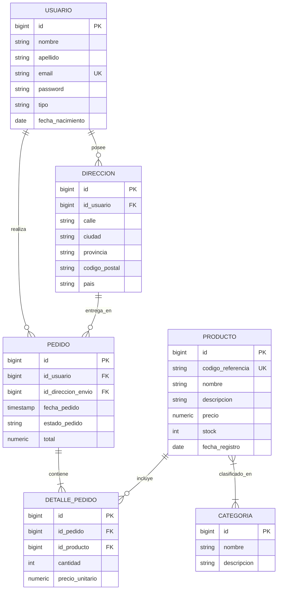

# 🛒 E-Commerce REST API

[](https://www.oracle.com/java/)
[](https://spring.io/projects/spring-boot)
[](https://spring.io/projects/spring-data-jpa)
[](https://www.postgresql.org/)
[](http://localhost:8080/swagger-ui.html)
[](https://opensource.org/licenses/MIT)

API RESTful backend para la gestión integral de una plataforma de comercio electrónico (**E-Commerce**), desarrollada con **Java 21 LTS** y el ecosistema **Spring Boot**.

Implementa una arquitectura limpia por capas (`Controller` $\rightarrow$ `Service` $\rightarrow$ `Repository`), persistencia relacional con PostgreSQL, control transaccional de pedidos y stock, DTOs inmutables con `record`, validaciones de entrada (`Bean Validation`) y documentación interactiva OpenAPI 3.0.

---

## 🏛️ Modelo de Dominio (Entity-Relationship)



---

## 🚀 Puesta en Marcha en Local

### Requisitos Previos
* **Java 21 JDK** instalado y configurado en el `PATH`.
* **Docker** y **Docker Compose** en ejecución.

---

### 1. Iniciar Base de Datos (PostgreSQL)
El proyecto incluye un `docker-compose.yaml` listo para desplegar PostgreSQL 16 Alpine:

```bash
docker compose up -d
```

* **Host**: `localhost:5432`
* **Base de datos**: `tienda-electronica`
* **Usuario**: `admin`
* **Password**: `admin`

---

### 2. Ejecutar la Aplicación con Maven Wrapper
No necesitas tener Maven instalado en el sistema:

```bash
./mvnw spring-boot:run
```

La aplicación arrancará por defecto en `http://localhost:8080`.

---

## 📖 Documentación OpenAPI / Swagger UI

La API cuenta con documentación viva generada automáticamente conforme a la especificación OpenAPI 3.0:

* **Swagger UI interactivo**: [http://localhost:8080/swagger-ui.html](http://localhost:8080/swagger-ui.html)
* **Especificación OpenAPI (JSON)**: [http://localhost:8080/v3/api-docs](http://localhost:8080/v3/api-docs)

---

## 📌 Resumen de Endpoints de la API

### Productos (`/api/v1/productos`)
| Método | Endpoint | Descripción |
| :--- | :--- | :--- |
| `GET` | `/api/v1/productos` | Listar todos los productos del catálogo |
| `GET` | `/api/v1/productos/{id}` | Obtener detalle de un producto por ID |
| `GET` | `/api/v1/productos/codigo/{codigo}` | Buscar producto por código de referencia |
| `POST` | `/api/v1/productos` | Registrar un nuevo producto con validaciones |
| `PUT` | `/api/v1/productos/{id}` | Actualizar datos de un producto |
| `DELETE` | `/api/v1/productos/{id}` | Eliminar un producto del catálogo |

### Categorías (`/api/v1/categorias`)
| Método | Endpoint | Descripción |
| :--- | :--- | :--- |
| `GET` | `/api/v1/categorias` | Listar todas las categorías disponibles |
| `GET` | `/api/v1/categorias/{id}` | Obtener una categoría por ID |
| `POST` | `/api/v1/categorias` | Crear una nueva categoría |
| `PUT` | `/api/v1/categorias/{id}` | Modificar información de una categoría |
| `DELETE` | `/api/v1/categorias/{id}` | Eliminar categoría |

### Pedidos (`/api/v1/pedidos`)
| Método | Endpoint | Descripción |
| :--- | :--- | :--- |
| `GET` | `/api/v1/pedidos` | Listar pedidos (filtrable por usuario) |
| `GET` | `/api/v1/pedidos/{id}` | Consultar detalle de un pedido y sus líneas |
| `POST` | `/api/v1/pedidos` | Crear pedido con control transaccional de stock |
| `PATCH` | `/api/v1/pedidos/{id}/estado` | Actualizar estado del pedido (PAGADO, ENVIADO, etc.) |

---

## 🧪 Ejecución de Pruebas Automatizadas

Para ejecutar la suite de pruebas unitarias y de integración:

```bash
./mvnw clean test
```
